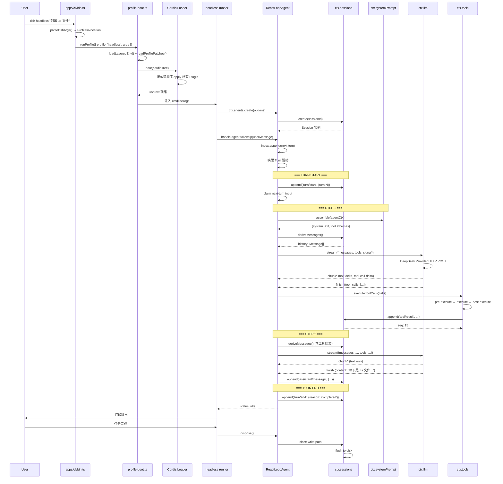

# 最小可运行示例：Headless 模式执行一条任务

## 场景描述

用户执行 `dsh headless "帮我列出当前目录下所有 .ts 文件"`，框架启动、创建 Agent、发起一轮模型调用、执行工具、输出结果后退出。

---

## 完整路径追踪

### 第 1 跳：CLI 入口 → 参数解析

**源码位置**：`apps/cli/src/bin.ts` +13-49、`apps/cli/src/args.ts` +1-80

```
进程启动
  → node apps/cli/lib/bin.js  (或 tsx 直接运行 src/bin.ts)
  → runCli({ packageManager })
    → parseDshArgs(argv.slice(2), version, manageDesktopProfile)
       argv = ['headless', '帮我列出当前目录下所有 .ts 文件']
       → 识别 mode: 'profile'
       → profile: 'headless'
       → args: ['帮我列出当前目录下所有 .ts 文件']
```

**参数解析规则**（`args.ts` +67-80）：
- `dsh <name>` → `--profile <name>` 缩写
- 第一个不被 launcher 识别的 token 开始 inner args
- `--patch` 可重复，收集为 overlay 列表

### 第 2 跳：Profile Boot → 加载配置

**源码位置**：`apps/cli/src/profile-boot.ts` +1-100、`packages/boot/app-boot/src/`

```
runProfile({
  environment: loadLayeredEnv('dsh'),  // 加载 .env
  profile: 'headless',
  args: ['帮我列出...'],
})
  → resolveProfileDir('headless', home)
     → $DSH_HOME/profiles/headless/
  → readProfilePatches(profileDir)
     → 读取 package.json 中的 dsh.profile.bundles
     → 读取 cordis.patch.yml
  → loadOverlayPatches(invocation.patches)  // --patch 覆盖层
  → boot(composedTree, { ... })
```

**Bundle 叠加顺序**：
```
空配置 []
  + dsh-base Bundle          → [llm, session, tools, agent, agent-loop, ...]
  + dsh-headless Bundle      → [+ headless runner plugin]
  + profile cordis.patch.yml → [+ 用户自定义覆盖]
  + --patch overlays         → [+ 命令行覆盖层]
```

### 第 3 跳：Cordis Loader → 挂载插件树

**源码位置**：`vendor/` 中 Cordis Loader + `packages/boot/app-boot/src/loader.ts`

```
Loader.boot(tree)
  │
  ├─ 拓扑排序所有 Plugin 条目（基于 inject 依赖）
  ├─ 依次调用每个 Plugin.apply(ctx)
  │   ├─ @deepseek-ai/dsh-session        → ctx.sessions 就绪
  │   ├─ @deepseek-ai/dsh-llm            → ctx.llm 就绪
  │   ├─ @deepseek-ai/dsh-llm-deepseek-api-key → DeepSeek Provider 注册
  │   ├─ @deepseek-ai/dsh-agent          → ctx.agents 就绪
  │   ├─ @deepseek-ai/dsh-agent-loop     → AgentLoop 工厂注册
  │   ├─ @deepseek-ai/dsh-tools          → ctx.tools 就绪
  │   ├─ @deepseek-ai/dsh-tool-bash      → bash 工具注册
  │   ├─ @deepseek-ai/dsh-tool-read      → read 工具注册
  │   ├─ @deepseek-ai/dsh-tool-write     → write 工具注册
  │   └─ ... (其他工具)
  │
  └─ Context 就绪，返回 LoaderContext
```

### 第 4 跳：Headless Runner → 创建 Agent

**源码位置**：`packages/bundle/headless/src/`（具体文件取决于实际布局）

```
headless runner plugin.apply(ctx)
  │
  ├─ 从 ctx.cmdlineArgs 读取 inner args
  │   → ['帮我列出当前目录下所有 .ts 文件']
  │
  ├─ ctx.agents.create({
  │     sessionId: auto-generated UUID,
  │     agentOptions: {
  │       provider: 'deepseek-official',
  │       model: 'deepseek-flash',
  │     },
  │   })
  │
  └─ 返回 AgentHandle
```

### 第 5 跳：Agent Loop 开始驱动

**源码位置**：`packages/core/agent-loop/src/agent.ts` +100-250

```
ReactLoopAgent 构造器
  │
  ├─ 创建 ReactLoopInbox（维护 next-turn / next-step 队列）
  ├─ 创建 RuntimeContextProjection
  ├─ 注册 turnBoundary 投影到 ctx.sessionProjections
  │
  └─ 等待 inbox 中有消息（由 runner 注入）
```

Runner 将用户消息注入 Inbox：

```
handle.agent.followup({
  content: [{ type: 'text', text: '帮我列出当前目录下所有 .ts 文件' }],
  source: { kind: 'user' },
})
  → Inbox.append(message, { target: 'next-turn' })
  → 唤醒 Agent Loop（如果 idle）
```

### 第 6 跳：Turn 开始 → 提示词组装

**源码位置**：`packages/core/agent-loop/src/agent.ts` +200-350、`packages/core/system-prompt/src/`

```
[Turn N Start]
  session.append('turn/start', { turn: N })

  // 从 Inbox 取出用户消息
  const messages = inbox.claimNextTurnInput()
    → 触发 agent/inbox/claimed 事件

  // 触发 agent/pre-step waterfall
  const decision = await dispatch.waterfall('agent/pre-step', { messages })
    → 监听器可改写或拒绝；此处直接 enter

  // 系统提示词组装
  const assembly = await systemPrompt.assemble(agentCtx)
    → 拼接所有 PromptSection
    → 注入当前可见工具 Schema
    → 返回 { systemText, toolSchemas, contextSections }

  // 历史推导
  const history = session.deriveMessages()
    → 读取所有 surface 事件
    → 附加最新 system/message 节点
    → 返回 Message[]
```

### 第 7 跳：LLM 流式调用

**源码位置**：`packages/llm/llm/src/index.ts`、`packages/llm/llm-deepseek/src/`

```
// 准备 Call 配置
const preparedCall = ctx.llm.prepareCall(
  { provider: 'deepseek-official', model: 'deepseek-flash', ... },
  signal,
)
  → 验证 adapter 已注册
  → 应用 adapter defaults（reasoningEffort、maxTokens）
  → deep-freeze 返回

// 流式调用
for await (const chunk of ctx.llm.stream({
  provider: 'deepseek-official',
  model: 'deepseek-flash',
  messages: history,
  tools: toolSchemas,
  signal,
})) {
  // chunk 类型：
  // { kind: 'block-start' }   — 新内容块开始
  // { kind: 'text-delta' }    — 文本增量
  // { kind: 'tool-call-delta' } — 工具调用增量
  // { kind: 'usage' }         — Token 用量
  // { kind: 'finish', finishReason } — 终止
}
```

**DeepSeek Provider 实现**（`packages/llm/llm-deepseek/src/`）：
- 构造 HTTP POST 到 DeepSeek API
- 设置 `Authorization: Bearer <API_KEY>`
- 解析 SSE 流响应
- 转换为 `StreamChunk` 格式

### 第 8 跳：工具调用执行

**源码位置**：`packages/core/agent-loop/src/tool-calls.ts`、`packages/core/tools/src/index.ts`

假设模型返回了一个 `list_files` 工具调用：

```
// 并行安全工具，放入 bounded pool
await executeToolCalls(toolCalls, {
  maxParallel: 10,
  dispatch,
  session,
})

// 对每个 toolCall：
// 1. tools/pre-execute waterfall
//    → 权限策略检查（是否允许执行此工具）
// 2. tools/execute waterfall
//    → 找到 ToolDefinition
//    → 调用 definition.execute(args, execContext)
//    → bash 工具：spawn bash -c "ls *.ts"
//    → 返回 ShellResult { stdout, stderr, exitCode }
// 3. tools/post-execute waterfall
//    → 结果替换/审计
// 4. session.append('tool/result', { ... })
//    → 追加到 Session 日志
```

### 第 9 跳：第二轮 Step（模型基于工具结果继续）

```
工具结果已追加到 Session 日志
  → session.deriveMessages() 现在包含 tool/result 消息
  → 再次进入 Step 循环

[Step 2]
  → 新的 prompt（含工具结果）
  → 新的 LLM 请求
  → 模型返回最终文本响应（无更多 tool calls）
  → session.append('assistant/message', { ... })
```

### 第 10 跳：Turn 结束 → 清理

**源码位置**：`packages/core/agent-loop/src/agent.ts` +500-705

```
[Turn N End]
  session.append('turn/end', { turn: N, reason: 'completed' })

  → agent/turn-stopping 事件（serial，无 next()）
  → 触发 agent/status { status: 'idle' }

  Runner 收集最终输出，打印到 stdout
  → handle.dispose()
    → Agent Loop 停止
    → Scope 解开
    → Session 写入路径关闭
    → 所有插件 disposer 按逆序调用
```

---

## 全流程时序图（Mermaid）



---

## 关键源码定位速查

| 阶段 | 关键源码 |
|---|---|
| 参数解析 | `apps/cli/src/args.ts` +1-80 |
| 入口分派 | `apps/cli/src/bin.ts` +26-55 |
| Profile 启动 | `apps/cli/src/profile-boot.ts` +271 |
| Agent 创建 | `packages/core/agent-loop/src/index.ts` +100-200 |
| Turn/Step 驱动 | `packages/core/agent-loop/src/agent.ts` +298-560 |
| 工具执行 | `packages/core/agent-loop/src/tool-calls.ts` +60-260 |
| Session 追加 | `packages/core/session/src/index.ts` +798 |
| 提示词组装 | `packages/core/system-prompt/src/index.ts` |
| LLM 调用 | `packages/llm/llm/src/index.ts` +1166 |
| Turn 结束 | `packages/core/agent-loop/src/agent.ts` +380-399 |
