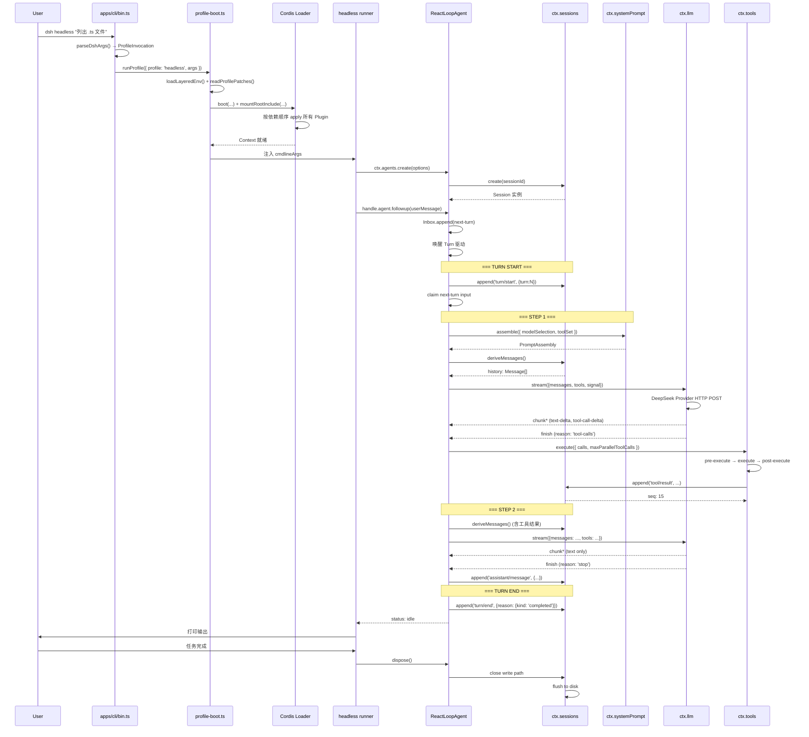

# 最小可运行示例：Headless 模式执行一条任务

[English](00-minimal-example.md) | 中文

这一页带你从头到尾跟着一条真实任务走一遍：从敲下命令，到插件装好、Agent 开跑、模型思考、工具执行，最后出结果、进程退出。每一跳都标注了源码位置，读完你就能把"命令行到模型响应"这条主链路完整串起来。配一张 Mermaid 时序图和一份源码速查表，方便回头定位。

## 场景描述

用户执行 `dsh headless "帮我列出当前目录下所有 .ts 文件"`，框架启动、创建 Agent、发起一轮模型调用、执行工具、输出结果后退出。整个过程不到十跳，每跳只做一件事：

---

## 完整路径追踪

十跳全景：解析命令 → 装配置 → 挂插件 → 建 Agent → 唤醒 → 组提示词 → 调模型 → 跑工具 → 再调模型 → 收尾退出。

### 第 1 跳：CLI 入口 → 参数解析

**源码位置**：`apps/cli/src/bin.ts` +13-49、`apps/cli/src/args.ts` +146

```
进程启动
  → node apps/cli/lib/bin.js  (或 tsx 直接运行 src/bin.ts)
  → runCli({ packageManager })
    → parseDshArgs(argv.slice(2), version, manageDesktopProfile)
       argv = ['headless', '帮我列出当前目录下所有 .ts 文件']
       → 识别 mode: 'profile'
       → profile: 'headless'
       → args: ['帮我列出当前目录下所有 .ts 文件']
```

**参数解析规则**（`args.ts`）：
- `dsh <name>` 重写为 `--profile <name>`
- 第一个不被 launcher 识别的 token 开始 inner args
- `--patch` 可重复，收集为 overlay 列表

### 第 2 跳：Profile Boot → 加载配置

这一跳把"启动套餐"翻译成一份具体的插件清单：先找目录，再读清单，最后叠加用户自己的覆盖层。

**源码位置**：`apps/cli/src/profile-boot.ts`、`packages/boot/app-boot/src/`

```
runProfile({
  environment: loadLayeredEnv('dsh'),  // 加载 .env
  profile: 'headless',
  args: ['帮我列出...'],
})
  → resolveProfileDir('headless', home)
     → $DSH_HOME/profiles/headless/
  → readProfilePatches(...)
     → 读取 package.json 中的 dsh.profile.bundles
     → 读取 cordis.patch.yml
  → loadOverlayPatches(invocation.patches)  // --patch 覆盖层
  → boot(...)
```

**Bundle 叠加顺序**：

```
空配置 []
  + dsh-base Bundle          → [llm, session, tools, agent, agent-loop, ...]
  + dsh-headless Bundle      → [+ headless runner plugin]
  + profile cordis.patch.yml → [+ 用户自定义覆盖]
  + --patch overlays         → [+ 命令行覆盖层]
```

### 第 3 跳：Cordis Loader → 挂载插件树

清单就绪后，Cordis 按依赖顺序把所有插件装进 Context，装完每个能力都在 ctx 上占一个键：

**源码位置**：`vendor/` 中 Cordis Loader + `packages/boot/app-boot/src/index.ts`（`boot`）

```
boot(...)
  │
  ├─ new Context() + ctx.plugin(Loader)   ← @deepseek-ai/cordis-plugin-loader
  ├─ mountRootInclude(...)                ← cordis:include 条目树 + patch 层
  ├─ prepare(ctx)                         ← profile 解析、插件包解析、cmdline 注入
  └─ loader.await()                       ← 按依赖顺序挂载全部条目
       ├─ @deepseek-ai/dsh-session        → ctx.sessions 就绪
       ├─ @deepseek-ai/dsh-llm            → ctx.llm 就绪
       ├─ @deepseek-ai/dsh-llm-deepseek-api-key → DeepSeek Provider 注册
       ├─ @deepseek-ai/dsh-agent          → ctx.agents 就绪
       ├─ @deepseek-ai/dsh-agent-loop     → AgentLoop 工厂注册
       ├─ @deepseek-ai/dsh-tools          → ctx.tools 就绪
       ├─ @deepseek-ai/dsh-tool-bash      → bash 工具注册
       └─ ... (其他工具)
```

### 第 4 跳：Headless Runner → 创建 Agent

headless 套餐自带一个"一次性 Runner"插件：等全树就绪、读命令行里的任务文本、创建 Agent：

**源码位置**：`packages/bundle/headless/src/startup.ts`、`packages/bundle/headless/src/index.ts`

```
headless-startup 行解析 cmdline（Commander: --json/--session-id/[task...]）
headless-runner 行 apply(ctx)
  │
  ├─ loader.await() 等待全树就绪
  ├─ ctx.cmdlineArgs 读取 inner args
  │   → ['帮我列出当前目录下所有 .ts 文件']
  │
  ├─ agents.create({ sessionId, meta: { cwd }, agentOptions, setup })
  │     agentOptions: { provider/model 来自 agentDefaultModel }
  │
  └─ 返回 AgentHandle
```

### 第 5 跳：Agent Loop 开始驱动

Agent 建好了但还在待命；Runner 把用户任务塞进 Inbox 并唤醒它：

**源码位置**：`packages/core/agent-loop/src/agent.ts`、`packages/core/agent-loop/src/index.ts`

```
ReactLoopAgent 构造器
  │
  ├─ 创建 ReactLoopInbox（折叠 agent/inbox/spliced 投影）
  ├─ 创建 RuntimeContextProjection + SystemPromptProjection
  └─ 等待 inbox 中有消息（由 runner 注入）
```

AgentLoop 服务在 init 时把 `inbox` 投影注册到 `ctx.sessionProjections`。

Runner 将用户消息注入 Inbox：

```
handle.agent.followup(createUserMessage(...))
  → Inbox.append(message, target='next-turn')
  → 唤醒 Agent Loop（如果 idle）
```

### 第 6 跳：Turn 开始 → 提示词组装

Turn 开始后先备料：取用户消息、拼系统提示词、从日志推导历史：

**源码位置**：`packages/core/agent-loop/src/agent.ts`、`packages/core/system-prompt/src/`

```
[Turn N Start]
  session.append('turn/start', { turn: N })

  // 从 Inbox 取出用户消息
  const messages = inbox.claim(target, turn)
    → 触发 agent/inbox/claimed 事件

  // preStep：组装 + agent/pre-step waterfall
  const tools = ctx.tools.resolve({ agent, modelSelection, signal })
  const assembly = await ctx.systemPrompt.assemble({ modelSelection, toolSet })
    → 拼接所有 PromptSection
    → 注入当前可见工具 Schema
    → 返回 PromptAssembly

  // 历史推导（buildRequest 内）
  const history = session.deriveMessages()
    → 读取所有 surface 事件
    → 附加最新 system/message 节点
    → 返回 Message[]
```

### 第 7 跳：LLM 流式调用

材料齐了，向模型发起流式请求。回复不是一次性到达，而是一段一段流回来：

**源码位置**：`packages/core/agent-loop/src/agent.ts` +613、`packages/llm/llm/src/index.ts`、`packages/llm/llm-deepseek/src/`

```
// 准备 Call 配置（prepareRequest 内）
const preparedCall = await ctx.llm.prepareCall(proposedConfig, signal)
  → 验证 adapter 已注册
  → 应用 adapter defaults（reasoningEffort、maxTokens）
  → 返回 PreparedLlmCall

// 流式调用（preparedCall 绑定同一 adapter generation）
for await (const chunk of stream) {
  // chunk 类型（StreamChunk.type）：
  // { type: 'block-start' }     — 新内容块开始
  // { type: 'text-delta' }      — 文本增量
  // { type: 'tool-call-delta' } — 工具调用增量
  // { type: 'usage' }           — Token 用量
  // { type: 'finish', reason }  — 终止
}
```

**DeepSeek Provider 实现**（`packages/llm/llm-deepseek/src/`）：
- POST 到 DeepSeek API
- 设置 `Authorization: Bearer <API_KEY>`
- 解析 SSE 流响应
- 转换为 `StreamChunk` 格式

### 第 8 跳：工具调用执行

模型说"我要看目录"，于是执行它要的工具。一批调用统一过"预检 → 执行 → 后处理 → 记日志"四道工序：

**源码位置**：`packages/core/agent-loop/src/agent.ts` +586、`packages/core/tools/src/batch.ts` + `pipeline.ts`

假设模型返回了一个工具调用：

```
// 一个 Step 的全部 tool calls 作为一个批次执行
await ctx.tools.execute({
  calls: toolCalls, signal, agent, log: { turn, step },
  maxParallelToolCalls, toolSet,
})

// 对每个 toolCall：
// 1. tools/pre-execute waterfall
//    → 权限策略检查（是否允许执行此工具）
// 2. tools/execute waterfall
//    → 找到 ToolDefinition
//    → 调用 definition.execute(args, execContext)
//    → bash 工具：spawn bash -c "ls *.ts"
//    → 返回 ShellResult { stdout, stderr, exitCode }
// 3. tools/post-execute waterfall
//    → 结果替换/审计
// 4. session.append('tool/result', { ... })
//    → 追加到 Session 日志
```

### 第 9 跳：第二轮 Step（模型基于工具结果继续）

工具结果写进日志后，模型再看一次全局，这次它直接给出答案、不再要工具：

```
工具结果已追加到 Session 日志
  → session.deriveMessages() 现在包含 tool/result 消息
  → 再次进入 Step 循环

[Step 2]
  → 新的 prompt（含工具结果）
  → 新的 LLM 请求
  → 模型返回最终文本响应（无更多 tool calls）
  → session.append('assistant/message', { ... })
```

### 第 10 跳：Turn 结束 → 清理

答案出来了，Turn 收尾；Runner 打印结果、拆掉 Agent、反序卸载所有插件：

**源码位置**：`packages/core/agent-loop/src/agent.ts` +395-427

```
[Turn N End]
  dispatch.serial('agent/turn-stopping', { turn, signal })
  session.append('turn/end', { turn: N, reason: { kind: 'completed' } })
  → phase 回到 idle，status emit 'idle'

  Runner 收集最终输出，打印到 stdout
  → handle.dispose()
    → Agent Loop 停止
    → Scope 解开
    → Session 写入路径关闭
    → 所有插件 disposer 按逆序调用
```

---

## 全流程时序图（Mermaid）

不想逐跳读文字的话，看这张图就够：左边是参与者，从上到下就是时间线。



---

## 关键源码定位速查

最后一张表：回头改代码或查问题时，按阶段直达源码位置。

| 阶段 | 关键源码 |
|---|---|
| 参数解析 | `apps/cli/src/args.ts` +146 |
| 入口分派 | `apps/cli/src/bin.ts` +26-55 |
| Profile 启动 | `apps/cli/src/profile-boot.ts` runProfile |
| Agent 创建 | `packages/core/agent-loop/src/index.ts` create/createAgent |
| Turn/Step 驱动 | `packages/core/agent-loop/src/agent.ts` turn/step |
| 工具执行 | `packages/core/tools/src/batch.ts` executeToolBatch |
| Session 追加 | `packages/core/session/src/index.ts` append |
| 提示词组装 | `packages/core/system-prompt/src/index.ts` assemble |
| LLM 调用 | `packages/llm/llm/src/index.ts` prepareCall/stream |
| Turn 结束 | `packages/core/agent-loop/src/agent.ts` turn finally 块 |
