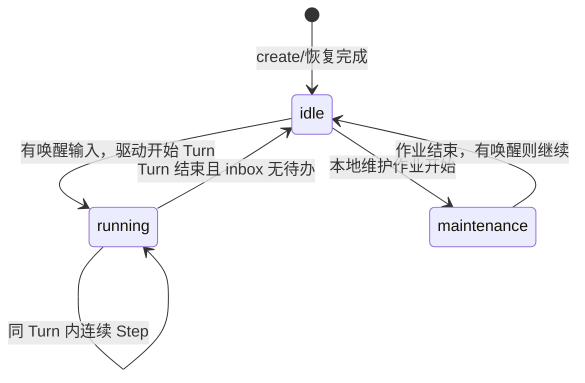

# dsh 中 Agent 的特点

## 0 一句话定位

在 dsh 里，**Agent 是一个"正在替用户干活"的运行实例**：官网对它的描述是能读写工作区文件、运行命令、委派工作、维护计划的执行者（`docs/user/guide/index.md`「Run a task」一节）；代码上它由三个角色拼成——`Agent` 接口定义"一个活的执行体"长什么样，`AgentRegistry`/`AgentFactory` 负责创建与登记，`AgentLoop` 是默认驱动实现，真正跑 Turn/Step 循环。

**边界澄清**：Agent 不是 Session。Session 是持久化的会话日志（崩溃后可重放），Agent 是驱动这份日志的活体，状态是进程内的；Agent 也不等于子代理（Subagent），子代理只是产生 Agent 并组成协作树的一种方式（见 [4.8](#48-子代理协作可以委派可以等结果)）。

## 1 官网口径：用户眼里的 agent

官网与用户文档对 agent 的描述可以归纳为四句话：

- **能干活**：用户在 Web UI 里开一个会话、发一句"总结这个仓库并指出主要包"，agent 就能读工作区文件、编辑文件、运行命令、委派工作、维护计划（`docs/user/guide/index.md`）。
- **有边界**：需要审批的操作，Web UI 会先询问，询问由当前权限策略决定（同上）。
- **能力可外挂**：官网把 agent 的能力拆成一列工具页——Bash 执行、子进程、后台任务、文件系统、LSP 导航、Web 访问、技能、工作流、子智能体（`docs/subsystems/` 各页），全部是可替换的插件。
- **框架定位**：站点自述是"用于构建 Agent Harness 的插件化 SDK"（`website/.vitepress/config.ts:180`），即 Agent 循环本身也只是插件之一。

代码侧与官网口径一一对应：架构文档的模块表直接写着 `core/agent` 提供"`Agent` 接口、活动注册表和 `agent/*` 事件，挂 `ctx.agents`"，`core/agent-loop` 是"实现该接口的默认驱动，挂 `ctx.agentLoop`"（`docs/architecture.md` 模块表）。

## 2 代码口径：Agent 的八个特点

| # | 特点 | 一句话 | 代码落点 |
|---|---|---|---|
| 1 | 接口与驱动分离 | `Agent` 只描述能力，`AgentLoop` 是可替换的默认实现 | `packages/core/agent/src/runtime-types.ts` · `Agent`；`packages/core/agent-loop/src/index.ts` · `AgentLoop` |
| 2 | 声明式创建与恢复 | 配置文件里写 `agents` 数组，启动时按身份创建或恢复 | `packages/core/agent-loop/src/index.ts` · `Config`、`[Service.init]` |
| 3 | Turn/Step 双层循环 | 一次对话是一个 Turn，每次问模型是一个 Step，Step 失败可重试 | `packages/core/agent-loop/src/agent.ts` · `turn`、`step` |
| 4 | 持久化收件箱驱动唤醒 | 所有输入先落 inbox 投影，驱动靠 `wakeRequested` 被唤醒，崩溃可恢复 | `packages/core/agent-loop/src/inbox.ts` · `ReactLoopInbox` |
| 5 | 流式累积与沉降 | 流式回复先攒后落：成功进模型历史，失败只留档 | `packages/core/agent-loop/src/assistant-stream.ts` · `AssistantStreamAttempt` |
| 6 | 工具调用与并行度 | 每个 Step 解析工具集并执行，并行安全调用默认上限 10 | `packages/core/agent-loop/src/constants.ts` · `DEFAULT_MAX_PARALLEL_TOOL_CALLS` |
| 7 | 全程可观察可拦截 | `agent/*` 事件覆盖状态、请求、流、边界，监听器可介入 | `packages/core/agent/src/runtime-types.ts` · `Agent` 事件面 |
| 8 | 子代理协作 | 统一激活 API 派生子代理，可向父级投递结果、可等结果 | `packages/subagent/subagent/src/index.ts` · `startActivation` |

下面先给出状态流转全貌，再逐条用代码引用详细讲解。

## 3 状态与流转全貌

一个 Agent 的生命周期由三态构成，图中状态名与代码 `Phase` 类型一致：

进入 `running` 后，驱动按"打开 Turn → 循环 Step → 收尾写 turn/end"推进；每个 Step 内部是"准备请求 → 组装 → 流式调用 → 有工具调用则执行并继续循环，无则结束"。落盘事件（`turn/start`、`step/start`、`assistant/message` 等）进入 Session 日志，进程内状态（`Phase`、inbox）是活的，两者通过事件对齐（细节见 `docs/agent-lifecycle.md` 时序图与 [4.3](#43-turnstep-双层循环)）。

## 4 代码级详细讲解

### 4.1 接口与驱动分离

`Agent` 接口只描述"一个活的执行体"的可见面：`options`（路由与输出控制）、`session`（它驱动的日志）、`model`（持久化模型选择）、`inbox`（待办）、`status`（`'idle' | 'running'`）、`ctx`（Agent 作用域上下文），加上 `cancel()` 等操作（`packages/core/agent/src/runtime-types.ts` · `Agent` `+0`）。

创建能力挂在 `AgentFactory` 接口上，由 `AgentRegistry` 消费：工厂提供 `createAgent(ownerCtx, options)` 与 `resume(ownerCtx, options)` 两个异步入口，返回的 `AgentHandle` 持有 `agent` 与 `dispose()`（`packages/core/agent/src/index.ts` · `AgentFactory` `+0`、`AgentHandle` `+0`）。注册表负责登记、按身份查找、发起者约束：

| 注册表方法 | 作用 |
|---|---|
| `AgentRegistry.setFactory` `+0` | 驱动在初始化时把工厂挂进来（`agentLoop.setFactory()`） |
| `AgentRegistry.requireInitiator` `+0` | 校验当前调用处于发起者作用域内，防止越权创建/操作 |
| `AgentRegistry.create` `+0` / `resume` `+0` | 创建/恢复的代理入口，把调用方上下文作为 `ownerCtx` 传给工厂 |

`AgentLoop` 就是默认驱动：它声明注入 `agents`、`sessions`、`llm`、`tools`、`systemPrompt`、`sessionProjections` 六个服务，并实现 `AgentFactory`（`packages/core/agent-loop/src/index.ts` · `AgentLoop` `+0`）。**含义**：换驱动只换实现，接口面（创建、恢复、取消、状态）不动。

### 4.2 声明式创建与恢复

`AgentLoop` 的配置结构是 `maxParallelToolCalls` + `agents` 数组，每个条目带稳定 `id`，可选固定 `sessionId`（重挂即恢复既有历史）、`cwd`（新会话工作区）、`resumeSessionId`（恢复指定持久化会话）（`packages/core/agent-loop/src/index.ts` · `Config` `+0`）。

启动时先做**身份冲突校验**再动手：`validateConfiguredAgents` `+0` 拒绝同一配置里"既有 `sessionId` 又有 `resumeSessionId`"和"两个条目争同一个精确身份"两种配置（`packages/core/agent-loop/src/index.ts` · `validateConfiguredAgents` `+0`）。随后 `[Service.init]` `+0` 依次注册两个投影（`modelSelection`、`inbox`）、挂工厂、注册系统提示词变量，再逐个处理配置条目：无精确身份的走创建，有 `resumeSessionId` 的走 `resumeWith`，已有 `sessionId` 且有持久化服务的走 `restoreOrCreateConfigured` `+0`（`packages/core/agent-loop/src/index.ts` · `[Service.init]` `+0`）。

`restoreOrCreateConfigured` 的关键分支：指定身份存在持久化会话就恢复并重放历史，否则按该身份新建；恢复路径上 `applyConfiguredRoute` `+0` 会把配置里的 provider/model 固化到 Agent 上（`packages/core/agent-loop/src/index.ts` · `restoreOrCreateConfigured` `+0`、`applyConfiguredRoute` `+0`）。启动失败通过 `agent-loop/config-start-failed` 事件广播，让等待该身份的消费者拒绝手里的活，而不是永远等下去。

另外 `INACTIVE_STATES` `+0` 定义了"关门谢客"三态（卸载中、已销毁、已失败），此时拒绝创建或恢复（`packages/core/agent-loop/src/index.ts` · `INACTIVE_STATES` `+0`）。

### 4.3 Turn/Step 双层循环

驱动入口是 `send(message, target, wakeup)` `+0`。四种发消息方式共用它：`followup` 走 `next-turn` 并唤醒（开新对话），`steer` 走 `next-step` 并唤醒（当前 Turn 内引导下一步），`inject` 走 `next-step` 不唤醒（只注入上下文）。一个细节：**唤醒输入不能加入已中止的活动**，所以若 Agent 正中止且需要唤醒，消息被重分类到 `next-turn`，避免在已中止的活动上浪费一次唤醒（`packages/core/agent-loop/src/agent.ts` · `send` `+0`）。

`turn()` `+0` 是 Turn 主循环：打开 Turn（写 `turn/start`）→ 循环取准入决策（`preStep`）→ 执行 Step → 写 `step/start`/`step/end` → 检查结束原因与下一批消息 → 必要时写 `turn/end` 收尾。返回 `true` 表示 inbox 还有活要干。`step()` `+0` 是单次"问模型"：内部带重试循环，依次做请求准备、系统提示词投影、写入 `system/message` 与 `user/message`、组装深冻结的 `GenerateOptions`、创建 `AssistantStreamAttempt` 消费流、按结束原因决定重试或收尾；有工具调用时执行工具并返回 `null` 继续循环，无工具调用时以 `completed` 或 `max-tokens` 结束（`packages/core/agent-loop/src/agent.ts` · `turn` `+0`、`step` `+0`）。

请求侧的两个组装函数：`prepareRequest` `+0` 读上次请求头、拼种子配置、跑 `agent/request` waterfall 并绑定 adapter；`buildRequest` `+0` 计算新请求头（区分 `initial`/`resume`/`change`/`series` 四种原因）、检测工具增减、把历史消息逐条深冻结后整体冻结（`packages/core/agent-loop/src/agent.ts` · `prepareRequest` `+0`、`buildRequest` `+0`）。**含义**：模型看到的东西（消息历史、请求头）全部可复现、可冻结，重试不会重复写系统消息。

### 4.4 持久化收件箱驱动唤醒

Agent 的待办不在内存里，而是一个 Session 投影：`inbox` 投影的状态是两个队列 `next-turn` 与 `next-step`，折叠逻辑对每个 `agent/inbox/spliced` 事件校验坐标与重复 id 后应用（`packages/core/agent-loop/src/inbox.ts` · `inboxProjectionDefinition`）。

`ReactLoopInbox` `+0` 是唯一变更入口的封装：

| 成员 | 作用 |
|---|---|
| `ReactLoopInbox.splice` `+0` | 公共变更入口：委托 `mutate` 落盘并通知 |
| `ReactLoopInbox.mutate` `+0` | 规范化坐标、查重、写 `agent/inbox/spliced`、对删除项发 `discarded`、对插入项发 `inserted` |
| `ReactLoopInbox.clear` `+0` | 清空两个队列（先 `next-step` 后 `next-turn`） |
| `ReactLoopInbox.claim` `+0` | 取出消息并触发 `claimed` 事件 |

唤醒的开关是 `wakeRequested`：`wakeDriver` `+0` 在需要时唤醒驱动，`cancel` 或维护作业开始时会把它清掉（`packages/core/agent-loop/src/agent.ts` · `wakeDriver` `+0`、`setPhase` `+0`）。**含义**：所有输入先落日志再唤醒，进程崩溃后从投影重放即可恢复待办，不会丢消息。

### 4.5 流式累积与沉降

模型流式回复由 `AssistantStreamAttempt` `+0` 逐段累积（`push` `+0` 快照 chunk、发布 `chunk` 帧），终态由 `settle` `+0` 决定：成功原因（`stop`、`tool-calls`、`max-tokens`）提交 `assistant/message` 进入模型历史；失败原因（`aborted`、`error`）提交 `assistant/attempt` 只留档不进历史；append 落盘失败时走 `abandon()`，只发终帧不写持久化事件（`packages/core/agent-loop/src/assistant-stream.ts` · `AssistantStreamAttempt` `+0`、`push` `+0`、`settle` `+0`）。

**含义**：模型历史里只有"算数的"回答；每次失败尝试都有完整存档（含嵌入的流记录），可审计、可重放，但不污染上下文。

### 4.6 工具调用与并行度

每个 Step 开始时向 `ctx.tools` 解析当前 Agent 可用的工具集（`resolve({ agent, modelSelection, signal })`），并行执行的安全上限是 `DEFAULT_MAX_PARALLEL_TOOL_CALLS` `+0`，值为 10（`packages/core/agent-loop/src/constants.ts` · `DEFAULT_MAX_PARALLEL_TOOL_CALLS` `+0`）。该值可经 `maxParallelToolCalls` 配置覆盖，配置是 `Volatile` 语义（可热更新）。工具是否暴露、参数 Schema 由工具注册表定义，循环只负责"解析—执行—把结果交回模型"。

### 4.7 全程可观察可拦截

`Agent` 事件面声明在 `packages/core/agent/src/runtime-types.ts`，按用途分三类：

| 事件 | 声明位置（行） | 用途与语义 |
|---|---|---|
| `agent/status` | `packages/core/agent/src/runtime-types.ts` · `Agent` 事件面 `+0`（L310） | 状态广播，`'idle' | 'running'` 每次迁移都发 |
| `agent/pre-step` | 同上（L351） | waterfall：监听器可接受、改写或拒绝本轮消息，决定本步是否进入 |
| `agent/request` | 同上（L374） | waterfall：请求组装后调整控制项，不能改 provider/model/effort |
| `agent/assistant-stream` | 同上（L400） | 流式帧广播（start/chunk/end），Web 会话跟随的实时来源 |
| `agent/turn-stopping` | 同上（L418） | serial：Turn 收尾前的同步钩子，无 `next()` |

创建/销毁的广播走 `ctx.serial('agent/created', ...)`（`packages/core/agent/src/index.ts` · `AgentRegistry.register` 内，L564），保证通知顺序。**含义**：观察、介入、替换行为都不需要改循环本身，这是官网"插件化"定位的机制落点。

### 4.8 子代理协作：可以委派，可以等结果

子代理由统一激活 API 管理：`SubagentManager` `+0` 是管理端，`startActivation` 提供三个重载（指定 `childId` 的本地子代理、普通本地或外部子代理、带执行能力的托管子代理），本地子代理返回激活句柄并带消息 id，外部执行只返回激活（`packages/subagent/subagent/src/index.ts` · `startActivation` `+0`、`+0`、`+0`；`packages/subagent/subagent/src/manager.ts` · `SubagentManager` `+0`）。

模型侧的三个工具挂在 `tool-subagent-control` 插件：`send_message`（向子代理投递消息）、`subagent:identity`（查询子代理身份）、`interrupt_agent`（中断指定子代理）（`packages/subagent/tool-subagent-control/src/index.ts` · 工具定义）。子代理的目录默认继承父代理当前有效目录，相对路径按父代理目录解析（`docs/subsystems/subagent.md`）。**含义**：官网说的"委派工作"在代码上是"激活一个受管子代理 + 向它投递消息 + 等待或打断它"，子代理本身也是一个按 [4.1](#41-接口与驱动分离)~[4.5](#45-流式累积与沉降) 同样规则运行的 Agent。

## 5 依赖与边界

- **无独立数据库、无消息队列**：状态全部在 Session 日志（JSONL，由 `dsh-session` 提供，`Session.append` `+0` 是写入入口，`Session.deriveMessages` `+0` 从日志投影模型历史；`packages/core/session/src/index.ts` · `Session.append` `+0`、`Session.deriveMessages` `+0`）。进程内通知用 `agent/*` 事件，两者职责分离：日志是模型可见的真相，事件是活的观察面。
- **模型调用一律经 `ctx.llm`**：驱动不直连任何 provider，`prepareCall` 绑定 adapter，换模型只换配置与插件（`packages/core/agent-loop/src/agent.ts` · `prepareRequest` `+0`）。
- **系统提示词经 `ctx.systemPrompt`**：组装在 `system-prompt` 包（`assemble` `+0`、`tools` `+0`），循环只调用投影，不自建提示词逻辑（`packages/core/system-prompt/src/index.ts` · `assemble` `+0`、`tools` `+0`）。
- **审批与权限不在循环内**：官网的"操作前询问"由交互与权限层承担（`docs/subsystems/approval.md`、`docs/subsystems/permission-presets.md`），Agent 循环只负责执行已放行的操作。

## 6 已知缺口与注意点

- **维护态是内部通道**：`maintenance` 态只服务本地维护作业（`runMaintenance` `+0`，`packages/core/agent-loop/src/agent.ts`），不对外承诺任何能力；[推断] 它会在作业结束且 inbox 有待办时重新唤醒驱动，代码路径已核实，但端到端行为未运行验证。
- **重分类边界**：`send` 的"唤醒输入遇到已中止活动重分类到 `next-turn`"只影响需要唤醒的消息，`inject`（不唤醒）不受此规则影响（`packages/core/agent-loop/src/agent.ts` · `send` `+0`）。
- **事件语义不对称**：`agent/pre-step`、`agent/request`、`agent/turn-stopping` 是 waterfall/serial，`agent/status`、`agent/assistant-stream` 是纯广播；监听器漏调 `next()` 会短路链条，属于使用方义务（`docs/architecture.md` 事件段）。
- **子代理后端差异**：指定 `childId` 的激活要求本地后端，外部后端会直接报 `UNSUPPORTED_CAPABILITY`（`packages/subagent/subagent/src/index.ts` · `startActivation` 实现）。

## 7 源码索引

正文锚点用"符号 + 偏移"；下表给出复核用绝对行号（`+0` 行 = 定义行）：

| 主题 | 文件 | 符号 | 行号 |
|---|---|---|---|
| Agent 接口本体 | `packages/core/agent/src/runtime-types.ts` | `Agent` | 191 |
| AgentStatus | 同上 | `AgentStatus` | 136 |
| 工厂与句柄 | `packages/core/agent/src/index.ts` | `AgentFactory` / `AgentHandle` | 171 / 160 |
| 注册表 | 同上 | `AgentRegistry` / `setFactory` / `requireInitiator` / `create` | 246 / 377 / 327 / 410 |
| Turn/Step 边界投影 | `packages/core/agent/src/projection.ts` | `turnBoundaryProjectionDefinition` | 21 |
| 驱动服务 | `packages/core/agent-loop/src/index.ts` | `AgentLoop` / `[Service.init]` / `Config` | 290 / 328 / 252 |
| 声明式启动 | 同上 | `validateConfiguredAgents` / `restoreOrCreateConfigured` / `applyConfiguredRoute` | 272 / 408 / 372 |
| 关闭态 | 同上 | `INACTIVE_STATES` | 41 |
| 驱动状态机 | `packages/core/agent-loop/src/agent.ts` | `send` / `turn` / `step` / `cancel` / `runMaintenance` / `wakeDriver` | 171 / 333 / 441 / 192 / 204 / 235 |
| 请求组装 | 同上 | `prepareRequest` / `buildRequest` | 619 / 662 |
| 收件箱 | `packages/core/agent-loop/src/inbox.ts` | `ReactLoopInbox` / `splice` / `mutate` / `clear` / `claim` | 73 / 166 / 186 / 97 / 108 |
| 流式沉降 | `packages/core/agent-loop/src/assistant-stream.ts` | `AssistantStreamAttempt` / `push` / `settle` | 18 / 60 / 78 |
| 工具并行上限 | `packages/core/agent-loop/src/constants.ts` | `DEFAULT_MAX_PARALLEL_TOOL_CALLS` | 6 |
| 事件声明 | `packages/core/agent/src/runtime-types.ts` | `agent/status` / `agent/pre-step` / `agent/request` / `agent/assistant-stream` / `agent/turn-stopping` | 310 / 351 / 374 / 400 / 418 |
| 会话日志 | `packages/core/session/src/index.ts` | `Session.append` / `Session.requestHeader` / `Session.deriveMessages` | 809 / 1007 / 1079 |
| 提示词组装 | `packages/core/system-prompt/src/index.ts` | `assemble` / `tools` | 621 / 552 |
| 子代理管理 | `packages/subagent/subagent/src/manager.ts` | `SubagentManager` | 139 |
| 子代理激活 | `packages/subagent/subagent/src/index.ts` | `startActivation`（三重载） | 252 / 259 / 267 |
| 子代理工具 | `packages/subagent/tool-subagent-control/src/index.ts` | `send_message` / `subagent:identity` / `interrupt_agent` | 44 / 86 / 120 |
| 计划模式投影 | `packages/plan/plan-mode/src/index.ts` | `planProjectionDefinition` | 135 |
| 待办工具 | `packages/todo/tool-todo/src/index.ts` | `todo_write` | 137 |

## 8 导航

- 上游概念：[architecture.md](../architecture.md)（模块表与 Turn 流程）、[agent-lifecycle.md](../agent-lifecycle.md)（Turn/Step 时序图）
- 同库分层：[`sourceReader/04-source/00-agent-loop.md`](../sourceReader/04-source/00-agent-loop.md)（逐函数解析）、[`sourceReader/03-detailed/00-agent-lifecycle.md`](../sourceReader/03-detailed/00-agent-lifecycle.md)（生命周期逐步拆解）
- 相关子代理：[子智能体 Subagents](../subsystems/subagent.md)（统一激活 API 的完整契约）
- 官网入口：[使用 Web UI](../user/guide/index.md)（产品口径的运行步骤）
