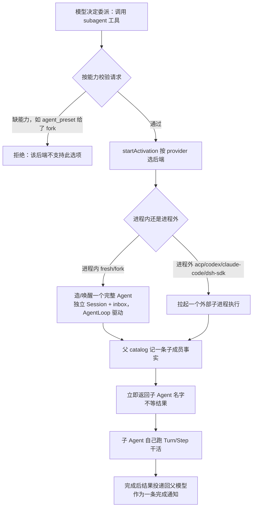
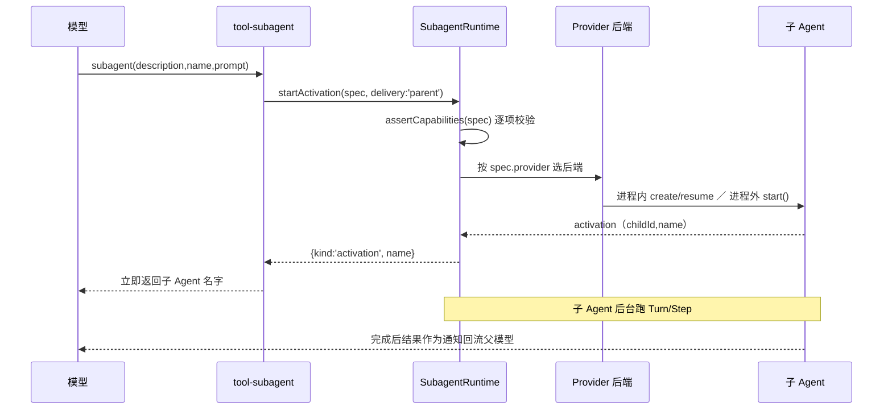

# dsh 中 Agent 编排与多 agent 合作

## 0 一句话定位

在 dsh 里，**一个 root Agent 可以把活儿委派给一群子 Agent，这群 Agent 共享一块任务板协同推进**。委派不是"调用一个函数"，而是**造出（或唤醒）一个和 root 同构的完整 Agent**——有自己的 Session、收件箱、由同一个 `AgentLoop` 驱动；多个这样的 Agent 组成一棵树，Team 再在树之上加一层"共享任务板"。

**三个容易混的词先分清**：

- **委派（delegation）**：root 让一个子 Agent 去干一件具体的事，子 Agent 干完把结果回报。这是 `subagent` 家族（能力缝）。
- **编排（orchestration）**：把"造子 Agent、续轮、发现、消息、中断、并发与深度控制"这套机制统起来，是本文主线。
- **协同（Team）**：在委派树之上共享一块任务板（谁领哪个任务、依赖谁、写哪些文件），是 `agent-team` 家族。Team **不**重新发明成员——成员就是 subagent。

**和谁互补**：本文讲"多个 Agent 怎么组队干活"；单 Agent 内部怎么跑 Turn/Step 见 [dsh 中 Agent 的特点](agent-characteristics.md)；四层源码阅读库见 [../sourceReader/README.md](../sourceReader/README.md)。

---

## 1 结论速览

| 你想知道 | 答案 | 代码落点 |
|---|---|---|
| 子 Agent 是不是完整 Agent？ | 是。独立 Session + 独立 inbox，由同一 `AgentLoop` 驱动 | `packages/subagent/subagent/src/manager.ts` · `materialize` |
| 有几种委派后端？ | 6 种：2 种进程内（fresh / fork）+ 4 种进程外（acp / codex / claude-code / dsh-sdk） | `packages/subagent/README.md` 包表 |
| 怎么统一触发？ | 一个激活 API `startActivation(spec)`，按 `spec.provider` 选后端 | `packages/subagent/subagent/src/index.ts` · `startActivation` |
| 模型用什么工具委派？ | `subagent`（默认名，可配）委派；`send_message` / `interrupt_agent` / `list_agents` / `wait_agent` 控制 | `packages/subagent/tool-subagent/src/index.ts`、`tool-subagent-control/src/index.ts` |
| 树能多深？ | 默认 `maxDepth = 1`（root 之下只一层），可配 | `packages/subagent/subagent/src/index.ts:198` |
| 同时能跑几个？ | 默认 `maxActiveSubagents = 8`，每棵子树共享一个槽池 | `packages/subagent/subagent/src/index.ts:199` |
| 子 Agent 叫什么？ | 1–32 位小写字母/数字/连字符、字母开头、不能叫 `lead`；省略则自动 `agent-N` | `packages/subagent/subagent/src/names.ts` · `isAgentName` |
| Team 靠什么记账？ | 以 root（Lead）Session 日志为唯一事实源，`team/task` 事件 + CAS 修订号防冲突 | `packages/team/agent-team/src/index.ts` · `TeamService` |
| Team 的成员从哪来？ | 就是 subagent，创建/收发复用 subagent 工具，Team 只加共享任务板 | `packages/team/tool-agent-team/src/index.ts` |

---

## 2 生产视角：一次委派实际发生什么

### 2.1 参与者与真实入口

- **root Agent（Lead）**：正在替用户干活的顶层 Agent，名字固定 `lead`。
- **委派工具**：模型在一步里决定"这活儿交给子 Agent"，于是发起委派。
- **子 Agent**：被造出来（或唤醒）的执行体，干完把结果送回。
- **Team 任务板**（可选）：开启 Team 模式后，成员之间用共享任务板分工。

用户看到的入口通常只有一句自然语言（"你把这个仓库审一下，拆给几个助手并行做"），模型自己决定要不要委派、委派几个。

### 2.2 主流程

要点（每条都能回到代码）：

1. **委派立即返回**：工具调用马上拿到 `{kind:'activation', name}`，不阻塞等子 Agent 干完。子 Agent 在后台跑，干完再通知。`packages/subagent/tool-subagent/src/index.ts` · `apply` 内 `delivery:'parent'`。
2. **子 Agent 是活的 Agent，不是函数**：进程内后端经 `ctx.agents.create()`（全新上下文）或 `ctx.agents.resume()`（冷恢复续轮）物化，拥有独立 Session 与收件箱。`packages/subagent/subagent/src/manager.ts` · `materialize`。
3. **父子关系被持久记录**：父 Session 写一条 `subagent/catalog` 事件，作为"我有哪些孩子"的持久事实，崩溃后仍可发现历史子 Agent。`packages/subagent/subagent/src/catalog.ts` · `establishCatalogChild`。
4. **结果回流是通知，不是返回值**：完成后以一条完成通知投递给父模型（`delivery:'parent'`）；也可以 `delivery:'caller'` 只把结果交给代码调用方、不打扰模型。

### 2.3 一次真实例子

用户说："审一下 `packages/core`，把可并行做的几件事分给助手。"

1. 模型调用委派工具：`subagent(description:"审 session 包", name:"session-auditor", prompt:"...")`。
2. 系统按默认后端 `spawn` 造一个全新子 Agent，命名 `session-auditor`（通过名字校验），在父 catalog 记一条成员事实，立即返回 `{kind:'activation', name:'session-auditor'}`。
3. 子 Agent 用自己独立的 Session 跑起来：读文件、跑命令、得出结论——它和 root 用的是**同一套** agent-loop。
4. 子 Agent 干完，结果作为一条完成通知回流到 root 模型的收件箱，root 下一步就能看到并汇总。
5. 若开了 Team 模式，root 也可以先在共享任务板上 `team_task_create` 建几个任务，再委派成员去 `claim`，靠任务板而非口头指派来分工。

### 2.4 失败与边界（当前代码行为）

| 情形 | 当前可见结果 | 代码落点 |
|---|---|---|
| 深度超限（已到 `maxDepth`） | 抛 `SubagentDepthError`（`DEPTH_EXCEEDED`）；提示层注入"剩余 0 级、勿再委派" | `packages/subagent/subagent/src/depth.ts` · `assertSubagentMaxDepth` |
| 并发已满 | 进入槽池排队/占槽受 `SubagentCapacity.limit` 约束（观测不占槽） | `packages/subagent/subagent/src/index.ts` · `capacityOf` |
| 名字重复 | 抛 `DUPLICATE_AGENT_NAME`（启动前同步占名防并发重名） | `packages/subagent/subagent/src/names.ts` · `SiblingNameReservations.reserve` |
| 请求了后端不支持的能力 | 逐项拒绝（如 fork 不支持 `agent_preset`） | `packages/subagent/subagent/src/index.ts` · `assertCapabilities` |
| 子 Agent 中途失败 | 结果以 `stopReason:'error'` resolve，不 reject；由消费层映射成 `isError` 工具结果 | `packages/subagent/subagent/src/types.ts` · `SubagentResult` |
| 找不到历史子 Agent 的描述 | 仍可发现，标为 `mode:'unknown'`，不给续轮能力 | `packages/subagent/subagent/src/list-children.ts` · `listDescendants` |

---

## 3 开发视角

### 3.1 能力缝：三角色分离

这是理解整套编排的钥匙。dsh 用"能力缝（capability seam）"把一个能力拆成三个互不依赖的角色（见 [docs/glossary.md](../../docs/glossary.md)「capability seam」）：

| 角色 | 谁来当 | 职责 | ctx key |
|---|---|---|---|
| **Service Definition** | `subagent/subagent` | 定义委派服务：provider 注册表、一次性运行、可续子 Agent、发现 | `ctx.subagents` |
| **Service Provider** | 六个后端包 | 各自实现"怎么真的跑起一个子 Agent" | 注册到 `ctx.subagents` |
| **Consumer** | `tool-subagent`、`tool-subagent-control`、`agent-team`、host | 把能力暴露给模型 / host，工具 schema 与措辞留在这层 | 注册到 `ctx.tools` |

三方互不 import：换一个 provider 不动工具，加一个工具不动服务定义。`packages/subagent/README.md` 的包表就是这个缝的目录。

### 3.2 委派后端清单

| 包 | 机制 | 默认 provider 名 | 继承父上下文 | 支持能力 | 关键符号 |
|---|---|---|---|---|---|
| `subagent-spawn-in-process` | 进程内 · 全新 | `spawn` | 否 | 全能力 true | `SpawnInProcessProvider` · `prepareContinuable` |
| `subagent-fork-in-process` | 进程内 · fork（用父已完成轮前缀做种子） | `fork` | 是 | `agentPreset=false`，其余 true | `ForkInProcessProvider` · `prepareContinuable` |
| `subagent-acp` | 进程外 · Agent Client Protocol | `acp` | — | `NO_START_CAPABILITIES` | `AcpProvider` · `start` |
| `subagent-codex` | 进程外 · 官方 app-server 协议 | `codex` | — | `NO_START_CAPABILITIES` | `CodexProvider` · `start` |
| `subagent-claude-code` | 进程外 · 官方 Agent SDK | `claude-code` | — | `NO_START_CAPABILITIES` | `ClaudeCodeProvider` · `start` |
| `subagent-dsh-sdk` | 进程外 · 另一 Harness 运行时（TS SDK） | `dsh-sdk` | — | 仅 `agentOptions=true` | `SdkSubagentProvider` · `start` |

两类执行契约（`packages/subagent/subagent/src/types.ts` · `SubagentProvider`）：

- **本地两类**实现 `prepareContinuable` → 可续轮。provider 只贡献一份"脱机数据" `ContinuableCreateSpec.seed`，子 Agent 的生命周期归 continuation manager 管。
- **外部四类**实现 `start()` → 一次性执行，返回 `SubagentRun` 句柄。外部子没有本地 Session，是发现树上的叶子。

fork 与 spawn 的区别就一句话：**fork 继承父已完成对话的前缀当上下文**（适合"接着当前思路继续深挖"），**spawn 是干净上下文**（适合"独立审一块、互不污染"）。代码用 `inheritsParentContext` 这一个布尔表达（`SpawnInProcessProvider` 为 false、`ForkInProcessProvider` 为 true）。

### 3.3 统一激活 API

输入 `SubagentActivationSpec`（`types.ts` · `SubagentActivationSpec`）关键字段：

| 字段 | 含义 |
|---|---|
| `provider` | 用哪个后端（`spawn` / `fork` / `acp` / …） |
| `label` | 短任务标签，进 catalog |
| `name` | 可选；省略则取首个空闲 `agent-N` |
| `childId` | 可选保留身份，仅本地后端 |
| `delivery` | `'parent'` 通知模型 ／ `'caller'` 只返回给调用方 |
| `signal` | 取消（发布前）；发布后调用方自己 `dispose()` |
| 继承自 `SubagentStartRequest` | `prompt`、`parent`、`cwd`、`agentOptions`、`agentPreset`、`outputSchema`、`maxDepth` |

输出 `SubagentActivation`（`types.ts` · `SubagentActivation`）：`childId`、`name`、`result: Promise<SubagentResult>`、`dispose()`（只停这一次激活，不波及后续 resume）。本地子额外带 `messageId`。

**能力自描述**（`types.ts` · `SubagentCapabilities`）：`agentOptions` / `agentPreset` / `outputSchema` / `depthLimit` 四个布尔。`startActivation` 经 `assertCapabilities` 逐项拒绝缺失能力——所以"fork 不支持选 preset"这类约束是数据驱动的，工具层据此动态改措辞，而不是写死。

### 3.4 模型可见工具面

**委派**（`tool-subagent/src/index.ts` · `apply`）：

- 工具名默认 `subagent`（`Config.toolName` 可改）。
- 参数：`description`（必填）、`name`（可选）、`prompt`（必填），可选 `agent_preset`；开 `modelSelection` 时另有 `provider` / `model` / `reasoning_effort`。
- 行为：解析 preset / model route → 预检 LLM 路由 → `startActivation({..., delivery:'parent'})` → 立即返回 `{kind:'activation', name}`。
- 按需额外注册 `list_subagent_models`（`modelDiscovery`）。
- 工具描述按 `inheritsParentContext` 二选一措辞，并提示"用 `send_message` 续轮 / 中途引导"。

**控制**（`tool-subagent-control/src/index.ts` · `apply`，与具体 provider 解耦、多委派工具共享）：

| 工具 | 参数 | 做什么 |
|---|---|---|
| `send_message` | `agent`、`message` | 投递到同树成员收件箱：运行中下一步生效、空闲者起新轮 |
| `interrupt_agent` | `agent` | 中断目标，即发即返、不等其停止 |
| `list_agents` | — | 列同树成员名/状态/描述与 `running/limit`；只列 `continuable` 成员 |
| `wait_agent` | `timeout_ms`（10s–3600s，默认 30s） | 等下一步输入；`timedOut:false` 表示有输入待投递 |

### 3.5 Team：编排之上的协同层

`TeamService`（`packages/team/agent-team/src/index.ts` · `TeamService`，ctx key `agentTeams`）以 **Lead（root）Session 日志为唯一账本**：

- **模式开关**：`setEnabled` 写 root 的 `team/mode` 事件，**只有 root 能改**，后代共享该模式。
- **共享任务板**：任务持久化为 root 的 `team/task` 事件（`journal.ts` · `appendAndFlush`，version 2），经 `teamProjection` 折叠；读写都先 `ctx.subagents.rootOf(caller)` 定位 root。
- **任务 DAG**：`blockedBy` 边必须指向未删除任务且保持无环；`revision` 是 CAS 值、每次变更 +1（`agent-team/src/types.ts` · `TeamTaskSnapshot`）。
- **状态机**：`pending`（未开始/已释放）→ `in_progress`（有 owner）→ `completed`；`deleted` 是保留墓碑。
- **写域 advisory**：`writeScopes` 是"建议性路径前缀"而非锁——它提示"这些文件我在动"，不强制互斥。

`tool-agent-team`（`packages/team/tool-agent-team/src/index.ts` · `apply`）条件注册（`{when: enabled(agent)}`）四个工具：`team_task_create`、`team_task_list`、`team_task_get`、`team_task_update`（带 `expected_revision` CAS，`action` ∈ claim / release / edit / set_dependencies / complete / reopen / reassign / delete），并注入共享 `TEAM_POLICY` 提示。

**与 subagent 的分工边界**（关键，别混）：

- 成员**就是** subagent——创建、收发消息复用 subagent 的 `subagent` / `send_message`，Team 不另造一套成员机制。
- Team 只加"共享任务板"这一层协同。
- 任务变更**不会**自动结束收件箱等待、加消息或拉起空闲 Agent——需要某个成员行动时，显式 `send_message`。这是有意为之：共享状态有明确 owner（root Session），发布只在 commit 点，避免"改个任务就惊动一片"。

### 3.6 关键机制与必须保持的规则

| 机制 | 规则 | 代码落点 |
|---|---|---|
| 深度 | 子深度 = 父深度 + 1；超过 `maxDepth`（默认 1）抛 `DEPTH_EXCEEDED`；持久化头部深度是单调下限，恢复后不得当顶层 | `depth.ts` · `delegationDepthOf`、`child-agent.ts` · `resolveChildDepth` |
| 并发 | `SubagentCapacity{running,limit}`，`limit` = `maxActiveSubagents`（默认 8）；每棵子树共享一个 `ActivationPool`，`materialize` 经 `pool.reserve(limit)` 占槽；`capacityOf` 只观测不占槽 | `index.ts:199`、`manager.ts` · `materialize` |
| 命名 | `/^[a-z][a-z0-9-]{0,31}$/u`，不得为 `lead`；全路径为从 root 的 slash 路径（`joinAgentPath`），任一环未命名则回退 Session id（`agentAddress`） | `names.ts` · `isAgentName`、`ROOT_AGENT_NAME` |
| 可续子 Agent | 本地 continuable 子可接受后续收件箱消息、可冷恢复（`agents.resume`）；one-shot / external 不可续，`send_message` / `list_agents` 均排除 | `index.ts`、`list-children.ts` · `listDescendants` |
| 委派作用域 | 子 Agent 权限范围在启动时固定、会话内不可扩权（审批策略钉 `never`）；沙箱覆盖/权限 preset 在委派边界捕获并作为 `source:'delegation'` 事件追加到子 log | `child-agent.ts` · `SUBAGENT_DELEGATION_CONTEXT` |
| provider 注册 | `registerProvider` 是 effect、HMR 安全；重名抛 `DUPLICATE_PROVIDER`；既无 `start` 也无 `prepareContinuable` 拒注册；启动中被替换抛 `PROVIDER_CHANGED` | `index.ts` · `registerProvider` |
| cwd | `cwd` 可选，相对路径按父当前目录解析，省略则继承；provider 收到前已解析为绝对路径 | `types.ts` · `SubagentStartRequest.cwd` |

### 3.7 设计思路小结（这套编排体现了什么原则）

1. **能力缝三角色**：服务定义 / provider / 消费者各居其位、互不越界，换后端不动工具、加工具不动服务。
2. **provider registry 可扩展 + 能力自描述**：新增后端只需实现 `prepareContinuable`（本地可续）或 `start`（外部单发）之一，能力用 `SubagentCapabilities` 声明，消费层据能力动态校验与措辞。
3. **子 Agent 复用同一 agent-loop**：委派不是新执行模型，而是用 `agents.create` / `agents.resume` 造出/唤醒一个与 root 同构的 Agent；深度、会话元数据、组合都在委派边界一次性装配。
4. **结果投递模型**：委派立即返回名字，完成通知自动回流父模型；`subagent/start`–`subagent/end` 生命周期事件对供 host/UI 投影，catalog 是父拥有的持久发现事实。
5. **Team 在编排之上加协同层**：共享任务板以 Lead log 为单一事实源、CAS 修订防冲突、写域 advisory 非锁、就绪不拉起 owner——"共享状态有明确 owner"与"发布只在 commit 点"两条原则贯穿始终。

---

## 4 验证与后续引用

### 4.1 代码回核

本文每条行为均回核到当前工作区源码（当前 master，2026-11-25 核实）。关键符号已逐一定位确认存在：`SubagentRuntime`、`startActivation`、`SubagentActivationSpec`、`SubagentProvider`、`SubagentCapabilities`、`materialize`、`establishCatalogChild`、`isAgentName`、`joinAgentPath`、`delegationDepthOf`、`SUBAGENT_DELEGATION_CONTEXT`、`listDescendants`、`TeamService`，以及工具名 `subagent`、`send_message`、`interrupt_agent`、`list_agents`、`wait_agent`、`team_task_create/list/get/update`、`list_subagent_models`。默认值 `maxDepth=1`、`maxActiveSubagents=8`、`SUBAGENT_CATALOG_VERSION=3`、`ROOT_AGENT_NAME='lead'` 均已在源码行确认。

**本文为代码推断 + 文档口径，未做真实多 agent 运行实测**；涉及实际并发/深度/外部 provider 行为的线上表现未在此环境实测。

### 4.2 后续引用与联动

| 想深入 | 去哪 |
|---|---|
| 单 Agent 内部怎么跑 | [dsh 中 Agent 的特点](agent-characteristics.md) |
| 委派服务完整契约 | [docs/subsystems/subagent.md](../../docs/subsystems/subagent.md)、[packages/subagent/subagent/README.md](../../packages/subagent/subagent/README.md) |
| Team 任务板契约 | [docs/subsystems/agent-team.md](../../docs/subsystems/agent-team.md)、[packages/team/agent-team/README.md](../../packages/team/agent-team/README.md) |
| 各后端 provider 的配置与限制 | `packages/subagent/` 下各包 README |
| 四层源码阅读 | [../sourceReader/README.md](../sourceReader/README.md) |

**改这些地方要联动本文**：`subagent/subagent/src/{index,types,manager,catalog,names,depth,child-agent,list-children}.ts`、`tool-subagent`、`tool-subagent-control`、`team/agent-team`、`team/tool-agent-team`——新增后端、改激活契约、改深度/并发/命名规则、改 Team 任务语义，都应回写本文对应表格与流程。
